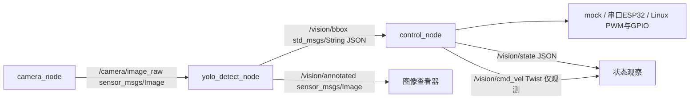

# ROS 2 Humble 视觉扫描与跟踪小车

已实现完整三节点 Python 工程、三种控制后端、ESP32 固件及无设备验收。默认只使用合成图像和模拟执行器，不发送真实电机运动。硬件尚未验证；当前开发环境是 Ubuntu 24.04 / ROS 2 Jazzy，Humble 目标环境应使用 Ubuntu 22.04 arm64 + Python 3.10。不要在 Ubuntu 24.04 强行安装 Humble deb。

本次完整结果见 [软件验收记录](VALIDATION.md)：19 项测试、两端三节点故障注入、真实 YOLO 回放及 ESP32 固件编译均通过。

## 工程目录

```text
src/
├── car_bringup/config/robot.yaml       # 唯一参数入口，包括话题/frame/限速/视觉参数
└── vision_car/
    ├── package.xml
    ├── setup.py
    ├── setup.cfg
    ├── requirements-yolo.txt          # 直接 pip 依赖；间接依赖由 pip 解析
    ├── resource/vision_car
    ├── launch/vision_car.launch.py
    ├── test/test_core.py
    ├── test/test_detection_validation.py
    ├── test/test_serial_driver.py
    └── vision_car/
        ├── __init__.py
        ├── common.py                 # 参数和退出清理
        ├── camera_node.py            # USB / 合成图像 / 本地视频
        ├── yolo_detect_node.py        # YOLOv8 / 明确标识的模拟检测
        ├── control_node.py            # 订阅、校验、看门狗和执行
        ├── core.py                    # 独立可测的控制状态机
        └── drivers.py                 # mock / ESP32串口 / Linux GPIO+PWM
firmware/esp32_vision_car/
├── platformio.ini                     # 固定 Arduino-ESP32 2.x 工具链
├── esp32_vision_car.ino               # 完整固件，可用 Arduino IDE 打开
└── src/main.cpp                       # PlatformIO 复用同一份固件
scripts/
├── test_vision_ros.py                 # 实际运行三节点及故障注入
├── test_vision_yolo.py                # 无设备真实模型推理/视频生成
├── test_vision_yolo_ros.py            # 视频+真实YOLO+mock执行器链路验收
└── sync_to_ubuntu.sh
docs/vision_car/results/              # 实际运行报告、日志、截图
```

## 数据流与控制逻辑



只运行三个 ROS 节点，读取和推理工作进程不是额外 ROS 节点。图像采用 sensor-data QoS，bbox/state 为 reliable，全部保留最新任务而非无限排队。`/vision/cmd_vel` 只用于观测，硬件后端由 control_node 直接调用；不自动接入现有 `/cmd_vel`，不要另启其他底盘控制器争用输出。

- `SCAN`：无目标且数据健康，底盘零速，云台在角度范围内匀速往返。
- `ACQUIRE`：首次捕获目标，冻结云台至少一个控制周期，底盘零速。
- `ALIGN`：按目标相对车体的方位角转车，同时将云台回中；不会保持侧视角直接前进。
- `APPROACH`：图像目标居中、车体方向误差和云台角均在阈值内，低速前进。
- `HOLD`：框面积达到停止阈值，零速保持。
- `LOST`：收到健康的空检测结果，立即停车；丢失持续超过参数值后重新扫描。
- `FAULT`：相机/推理结果中断、超时、消息不合法、重复/乱序或时间戳过期，停止底盘并暂停云台；健康数据恢复后才能重新搜索。
- `DRIVER_WAIT/DRIVER_FAULT`：驱动尚未握手或异常，底盘零速；串口 ACK 中断后后端永久锁止至重启。

图像右方偏移为正、车体左转角速度为正。目标车体系方位约为 `拍摄时云台角 - atan(水平归一化偏移 * tan(水平视场角/2))`。控制器缓存云台命令历史，按原始图像时间取最近角度补偿推理延迟；这不是舵机位置反馈，实机需校准舵机机械滞后。固定选择当前置信度最高的目标，未实现跨帧目标 ID 锁定，多目标可能切换。

单目框面积仅用于靠近后的启发式停止，**不能保证实际距离或避障**。无测距传感器时仅限空旷、隔离、有人监护的低速测试。无目标扫描不等于丢失相机；感知故障不会继续盲扫。

## 1. 安装与编译（无设备）

以下在已正确安装 ROS 2 的 Ubuntu 上执行。Humble 用 Ubuntu 22.04；当前 Ubuntu 24.04 虚拟机把第一行改为 `source /opt/ros/jazzy/setup.bash`。

```bash
source /opt/ros/humble/setup.bash
cd ~/ros2
sudo apt update
sudo apt install python3-colcon-common-extensions python3-opencv python3-numpy \
  python3-yaml python3-serial python3-pytest python3-venv python3-pip \
  ros-$ROS_DISTRO-cv-bridge ros-$ROS_DISTRO-sensor-msgs \
  ros-$ROS_DISTRO-geometry-msgs ros-$ROS_DISTRO-rqt-image-view
colcon build --symlink-install --packages-select car_bringup vision_car
source install/setup.bash
```

通过条件：`2 packages finished`；如果已编译 car_bringup，可只选择 vision_car。无需 YOLO/pip 即可运行下面的逻辑模拟。

## 2. 运行三节点模拟

Ubuntu 终端 A：

```bash
cd ~/ros2
source /opt/ros/$ROS_DISTRO/setup.bash
source install/setup.bash
ros2 launch vision_car vision_car.launch.py
```

终端 B（同样 source 环境）：

```bash
ros2 topic echo /vision/state
```

终端 C（有桌面时）：

```bash
ros2 run rqt_image_view rqt_image_view /vision/annotated
```

通过条件：每约 18 秒循环出现目标进入、居中、变大和消失，终端打印框、类别与置信度；状态出现 SCAN → ACQUIRE → ALIGN → APPROACH → HOLD → LOST → SCAN，无目标和故障时线/角速度均为零。这里识别绿色矩形，标签 `sim_target`，不是 YOLO 准确率测试，也不是 Gazebo 物理/动力学仿真。

自动验收在**没有其他演示进程的单独终端**运行，脚本自动隔离 ROS_DOMAIN_ID=89、仅本机发现，不接硬件：

```bash
cd ~/ros2
source /opt/ros/$ROS_DISTRO/setup.bash
source install/setup.bash
PYTHONPATH="src/vision_car:$PYTHONPATH" python3 -m pytest -q src/vision_car/test
python3 scripts/test_vision_ros.py
```

通过条件：19 项单元测试通过；约 35 秒后 `ros_report.json` 中 `passed: true`，涵盖全部状态、限速、三个节点存活及相机断开/推理进程退出/推理超时停车。查看 `docs/vision_car/results/simulation.jpg` 和 `state_trace.json`。

## 3. 安装真实 YOLOv8（仍不接硬件）

Humble 的 cv_bridge 使用系统 Python，所以创建带系统包的独立 venv，**不要 pip 安装 rclpy 或 cv_bridge**。先 source ROS，再创建/激活 venv；这些命令会下载 PyTorch 等较大包。

```bash
cd ~/ros2
source /opt/ros/$ROS_DISTRO/setup.bash
python3 -m venv --system-site-packages .venv-vision
source .venv-vision/bin/activate
python -m pip install --upgrade pip
python -m pip install -r src/vision_car/requirements-yolo.txt
python -m pip check
```

直接 pip 包全部在 requirements 文件：`numpy==1.26.4`、`ultralytics==8.3.40`、`torch==2.5.1`、`torchvision==0.20.1`、`opencv-python==4.10.0.84`、`pyserial==3.5`、`PyYAML==6.0.2`、`pytest==8.3.3`、`setuptools==69.5.1`。pip 自动安装其传递依赖，包括 scipy、matplotlib、pillow、pandas、seaborn、requests、tqdm、psutil、py-cpuinfo、ultralytics-thop 及 Torch 运行依赖；不同 CPU/Python 平台的完整解析结果不同，部署成功后用 `python -m pip freeze > vision-environment.lock.txt` 固化。

固定 NumPy 1.x 是为了避免 Humble cv_bridge ABI 冲突。32 位 Orange Pi 系统不在这套 PyTorch wheel 目标内；请先确认 `uname -m` 是 aarch64，且使用板卡支持的 Ubuntu 22.04 镜像。

**重要：重新编译 vision_car，使 console_scripts 的 Python 解释器指向 venv**（只激活 venv 再运行旧的 ros2 run 不会改变旧脚本 shebang）：

```bash
source /opt/ros/$ROS_DISTRO/setup.bash
source .venv-vision/bin/activate
python /usr/bin/colcon build --symlink-install --packages-select vision_car
source install/setup.bash
head -1 install/vision_car/lib/vision_car/yolo_detect_node
```

应显示 venv Python 路径。若 colcon 不在 venv 可见范围，确认创建时使用了 `--system-site-packages` 并已 apt 安装 colcon。

下载官方模型和样本到测试目录；下载不应发生在自动驾驶回调中：

```bash
mkdir -p ~/vision-assets
curl -fL https://github.com/ultralytics/assets/releases/download/v8.3.0/yolov8n.pt \
  -o ~/vision-assets/yolov8n.pt
curl -fL https://ultralytics.com/images/bus.jpg -o ~/vision-assets/bus.jpg
python scripts/test_vision_yolo.py --model ~/vision-assets/yolov8n.pt \
  --image ~/vision-assets/bus.jpg
```

通过条件：输出真实 person/bus 框、置信度和耗时，并生成 `results/yolo/annotated.jpg`、`yolo_report.json` 和 `replay.avi`。模型文件必须存在；节点不会隐式联网下载权重。

用视频回放启动**真正三节点 YOLO 链路**，不需要 USB 摄像头：

```bash
ros2 launch vision_car vision_car.launch.py simulate_camera:=false \
  simulate_detector:=false driver:=mock \
  model:=$HOME/vision-assets/yolov8n.pt \
  video_file:=$HOME/ros2/docs/vision_car/results/yolo/replay.avi
```

首次加载/预热可能使推理超时，控制器会停车；不能为了让车动而盲目扩大超时。CPU 跟不上时降低相机 fps / imgsz，先用 mock 驱动验证新鲜帧率，再评估是否需要加速硬件。默认结果超过 0.7 秒就拒绝驱车，推理超过 2 秒终止子进程；模型启动单独允许 60 秒。

也可在 venv 中执行自动真实 YOLO 链路验收（仍为 mock 执行器）：

```bash
python scripts/test_vision_yolo_ros.py --model ~/vision-assets/yolov8n.pt \
  --video docs/vision_car/results/yolo/replay.avi
```

通过条件：`results/yolo_ros/report.json` 中 `passed:true`，收到 `backend:yolov8` 的真实检测框、带框图及控制器接收结果。

## 4. 参数和消息接口

所有参数位于 `src/car_bringup/config/robot.yaml` 的 `vision` 下；限速只取顶层 `limits`，图像话题/frame 取既有 `topics.camera/robot.camera_frame`。修改后重编译；或 launch 传入绝对路径 `config:=<修改后的完整robot.yaml>`。节点也支持 `--ros-args -p 名称:=值`。launch 参数有 `config`、`simulate_camera`、`simulate_detector`、`driver`、`hardware_enabled`、`model`、`video_file`。

| 参数 | 默认 | 含义 |
|---|---:|---|
| scan_min / scan_max | -60 / 60 | 云台角度范围（度，左正） |
| scan_speed | 25 | 扫描/回中速度 deg/s |
| center_threshold | 0.12 | 中心偏移阈值，归一化至半幅宽 |
| forward_speed / turn_speed | 0.10 / 0.35 | m/s、rad/s，受统一限速约束 |
| horizontal_fov / align_degrees | 62 / 5 | 视场角/车体对准阈值（度） |
| stop_area | 0.30 | 框面积比例，达到后保持 |
| stale_timeout | 0.7 | 图像原始时间戳及结果接收超时（秒） |
| target_lost_timeout | 0.5 | 丢失后停车等待再扫描（秒） |
| inference_timeout / startup_timeout | 2 / 60 | 推理/模型加载超时（秒） |
| confidence / target_class | 0.5 / person | YOLO 筛选，空类别表示全部 |
| capture_timeout | 2 | 相机读超时后重建采集进程（秒） |

bbox 为 `std_msgs/String` 内的 JSON，避免另建自定义消息编译包。成功格式：

```json
{"ok":true,"stamp_sec":100,"stamp_nanosec":0,"width":640,"height":480,"backend":"yolov8","boxes":[{"class_id":0,"label":"person","confidence":0.91,"xyxy":[200,100,380,420]}]}
```

健康但无目标：`ok:true, boxes:[]`；故障：`{"ok":false,"error":"原因","boxes":[]}`。图像时间戳保留到 bbox 和带框图。控制节点拒绝非有限数值、越界框、尺寸错误、过期/未来/重复/乱序包。真实 USB 与控制节点使用系统时钟，不配置 `use_sim_time`；分机运行须同步系统时钟。

## 5. 接线与 PWM/L298N

先按主运行手册阶段 1–9 逐项验收，尤其供电、急停、串口、底盘独立驱动、架空低速方向验证和相机。**以下是接口说明和验收通过后使用的配置，不代表当前已具备上车条件。** 未获硬件验收证据前继续使用 mock；不得远程自动执行实体运动。

通用接线：USB 相机接香橙派 USB；舵机使用独立、符合型号规格且电流足够的稳压供电，信号接 PWM；舵机地、主控地、驱动逻辑地共地。不可用 GPIO 给舵机/电机供电，也不可把 5V 接入香橙派/ESP32 GPIO。电池经保险/实体急停向电机驱动供电。L298N 逻辑电源、板载 5V 稳压跳帽和续流二极管必须按实际模块说明确认，不能假设所有模块接法相同。

舵机信号使用 50Hz PWM（20ms 周期），默认中位 1500µs、每度 10µs，范围限制 600–2400µs；这是需要按舵机型号校准的初始配置，不保证所有舵机安全。先断开机械负载校准中位和左右极限，再装云台。ESP32 后端在固件修改这些常量；Linux 后端在 robot.yaml 修改。方向用 servo_sign 校准。

| ENA/ENB | IN1/IN3 | IN2/IN4 | 单侧电机行为 |
|---|---|---|---|
| 0 | 任意 | 任意 | 输出禁用，滑行停止 |
| PWM | 1 | 0 | 正转，PWM 调速 |
| PWM | 0 | 1 | 反转，PWM 调速 |
| 1 | 0 | 0 | 两端同电位，制动；本程序不用此模式 |

L298N 左电机接 OUT1/OUT2，右电机接 OUT3/OUT4。使用 PWM 调速需移除 ENA/ENB 常使能跳帽，并对 ENA/ENB 加合适的下拉，避免上电悬空。速度混控 `left=v-w*轮距/2`、`right=v+w*轮距/2`，再按标定最大轮速归一化并等比限幅。左转时左轮更慢、右轮更快。开环 PWM 不是编码器闭环速度控制，m/s 只是标定近似。L298N 有压降和发热，应按实际电机堵转电流及散热选型。

### 方案 A：香橙派 USB 串口 → ESP32 → 舵机 + L298N

固件给出的是 **经典 ESP32 DevKit** 的明确参考接线；其他板型需查原理图调整，不能把这些 GPIO 编号当作香橙派物理针脚。

| ESP32 GPIO | 接口 |
|---|---|
| 18 / 19 | L298N IN1 / IN2，左轮方向 |
| 21 / 22 | L298N IN3 / IN4，右轮方向 |
| 25 / 26 | L298N ENA / ENB，20kHz、8bit PWM |
| 27 | 舵机信号，50Hz、16bit PWM |
| GND | 驱动和舵机电源地 |
| USB | 香橙派 USB，115200 8N1，无流控 |

固件无第三方 Arduino 库，使用固定 Arduino-ESP32 2.x 的 LEDC API。Arduino 3.x 已移除 `ledcSetup/ledcAttachPin`，不要混用；PlatformIO 配置固定 espressif32@6.9.0。以下仅编译，不上传、不驱动：

```bash
# 可在独立开发 venv 中安装；PlatformIO 不属于 ROS 节点运行依赖。
python -m pip install platformio==6.1.18
python -m platformio run -d firmware/esp32_vision_car
```

上传固件必须先完成供电、急停、设备识别及架空验收，由现场操作员按实际板卡/端口进行；本工程不自动刷写设备。

串口协议为 ASCII、换行结尾：

```text
V 12 0.1000 -0.2000 30.00\n
ACK 12\n
```

依次是指令标记、递增序号、v(m/s)、w(rad/s)、pan(deg，左正)。负 w 右转。首次握手必须零速；香橙派未收到 ACK 时只发送零速。固件限定 |v|≤0.15、|w|≤0.5、|pan|≤85；非法/超长帧立即停；300ms 没有效指令自动停且要求重新零速握手。主机 ACK 超过 0.4 秒中断后锁止直到重启。协议不具备加密、校验和或身份认证，仅用于本机短距 USB；不是安全认证控制协议。ACK 只代表解析执行，不证明电机实际转速。

主控配置填入 `/dev/serial/by-id/<实际ESP32>`；固件 TRACK/WHEEL_MAX/方向/舵机标定应与 robot.yaml 一致（串口只传 v,w,pan，标定在固件执行）。当前没有真实串口 ID，配置保留空值并拒绝启动实体后端。

### 方案 B：香橙派直接 PWM + GPIO

支持 Ubuntu 22.04 的 python3-libgpiod **v1 API** 及 Linux sysfs 硬件 PWM，不使用树莓派 RPi.GPIO，不猜测香橙派板型针脚。需要三路实际可用硬件 PWM：左 ENA、右 ENB、舵机；方向脚使用四个 GPIO line offset。先按照板卡原理图、设备树 overlay 和内核文档导出 PWM，验证复用，确保非 root 运行用户可访问对应 sysfs 和 gpiochip。

```bash
# 仅安装直连后端时需要，Humble/Ubuntu 22.04：
sudo apt install python3-libgpiod gpiod
# 只读识别可用 GPIO 与 PWM；不能据此猜物理针脚：
gpioinfo
ls /sys/class/pwm/
```

填写 `gpio_chip`、`direction_lines`、`left_pwm/right_pwm/servo_pwm` 的实际值。程序会先使能零占空比，20kHz 控制电机、50Hz 控制舵机，清理时撤销 PWM。sysfs PWM 是硬件输出，进程被 SIGKILL 后可能仍保持原占空比；**必须配备能独立切断 ENA/ENB 的外部硬件看门狗**并现场验证，再设置 `external_watchdog_confirmed:true`。未确认时 Linux 后端拒绝启动。若没有这类硬件，使用带固件看门狗的 ESP32 方案；Python 退出清理不能替代断线急停。

## 6. 实机切换条件与命令模板

仅在主手册对应阶段逐项通过、有急停、驱动轮架空、低速、现场人员监护、已确认接线/角度/方向/串口后，才允许现场操作员使用以下模板。当前没有这些证据，因此本文不代表允许立即上车执行。

先用真实相机 + YOLO + **mock 底盘**检查画面/新鲜度：

```bash
ros2 launch vision_car vision_car.launch.py simulate_camera:=false \
  simulate_detector:=false driver:=mock model:=<yolov8n.pt绝对路径>
```

相机和模型验收通过且已有低速电机验收证据后，现场启用 ESP32 模板：

```bash
ros2 launch vision_car vision_car.launch.py simulate_camera:=false \
  simulate_detector:=false driver:=serial hardware_enabled:=true \
  model:=<yolov8n.pt绝对路径>
```

直连模板仅把 driver 改成 linux，且额外满足外部看门狗要求。launch 拒绝任何合成图像、视频回放或模拟检测与实体驱动混用。Ctrl+C 正常退出时停车；真实急停仍必须能独立切断驱动。首次确认右侧目标对应右转、云台侧视时不前进，之后才在隔离场地落地；失败立即停机回到对应阶段排查。

## 参考依据

- [ROS 2 Humble Ubuntu 安装平台](https://docs.ros.org/en/humble/Installation/Ubuntu-Install-Debs.html)
- [Ultralytics 推理接口](https://docs.ultralytics.com/modes/predict/)，使用 YOLOv8 权重与 boxes.xyxy/conf/cls、result.plot。
- [ESP32 Arduino 2.x→3.0 API 变更](https://docs.espressif.com/projects/arduino-esp32/en/latest/migration_guides/2.x_to_3.0.html)
- [ST L298 数据手册](https://www.st.com/resource/en/datasheet/l298.pdf)，使能、方向及电气限制以实际模块/器件规格为准。
